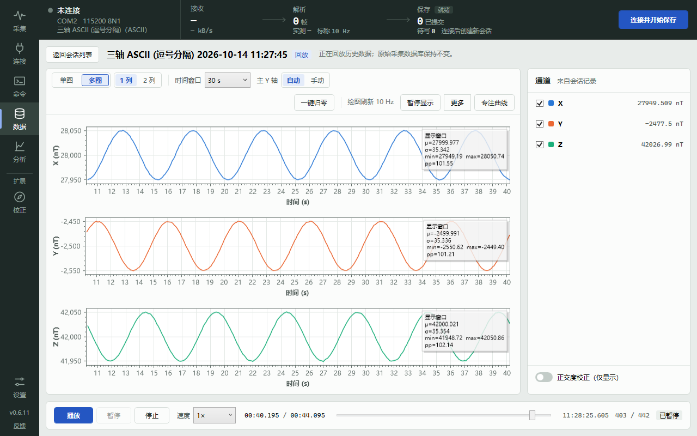
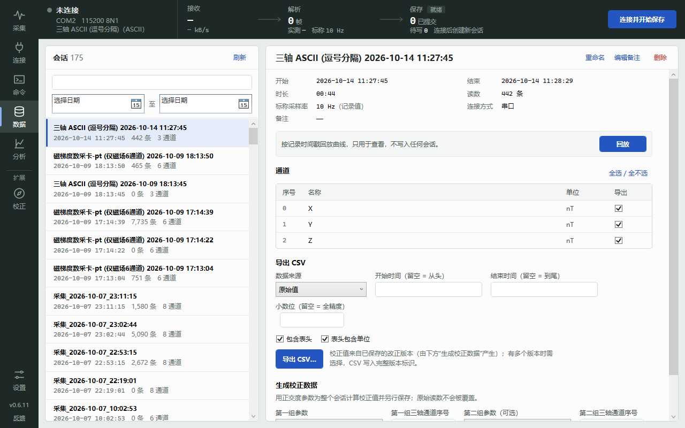
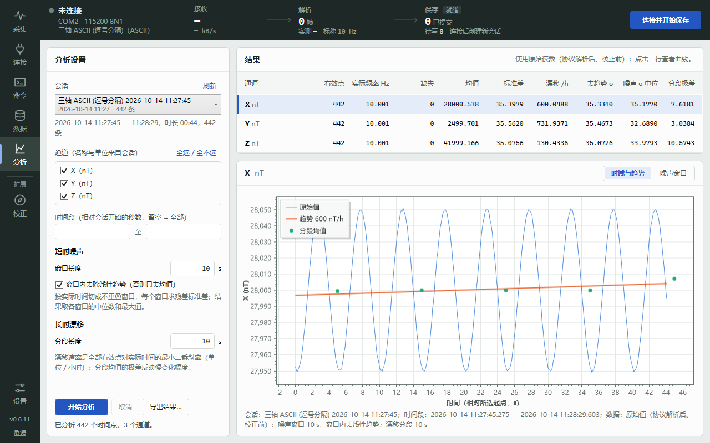
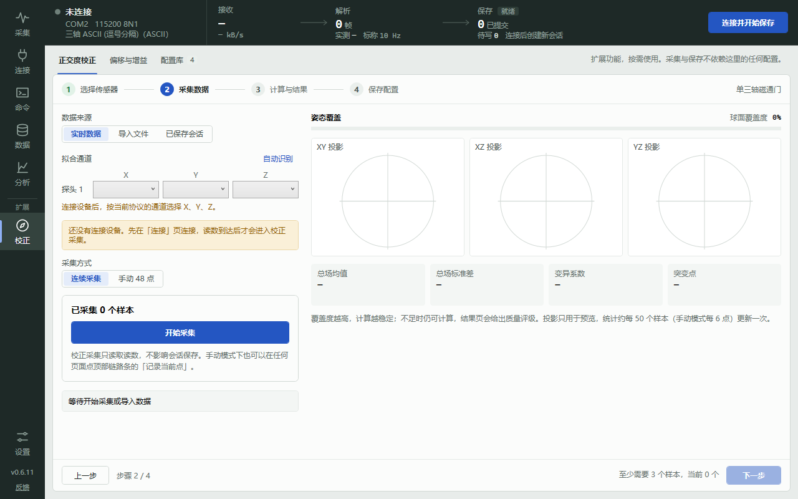

# MagnetometerSystem

[](https://github.com/YIALU/MagnetometerSystem/releases/latest)
[](https://github.com/YIALU/MagnetometerSystem/actions/workflows/windows-ci.yml)
[](LICENSE)

[English](README.en.md) · [下载最新版本](https://github.com/YIALU/MagnetometerSystem/releases/latest) · [使用说明](docs/使用说明.md) · [更新记录](docs/变更日志.md)

**MagnetometerSystem 是面向日常调试与实验记录的通用磁力仪上位机。** 通过串口或 TCP 连接设备，按用户定义的通信协议接收数据，自动保存原始读数，并实时绘制曲线。

项目以**协议可定制、数据可保存、曲线可观察**为核心。通道数量、名称和单位由协议配置，便于接入不同的数据格式，也可以同时观察磁场、温度及其他辅助通道。数据改正和高级分析作为可选工具，按需要使用。



## 界面预览

| 数据：会话列表、通道与导出 CSV | 分析：噪声与漂移 | 校正：正交度校正向导 |
| --- | --- | --- |
|  |  |  |

截图使用模拟器生成的三轴数据（回放已保存会话），采集时的曲线界面与此相同。

## 主要功能

- **连接与协议**：串口或 TCP 连接。ASCII 与二进制协议可配置字段映射、帧结构、字节序、缩放、校验和通道单位，协议可导入、导出为 JSON。按协议关联的命令组填写参数发送命令，也可自由发送 ASCII / HEX。
- **可靠记录**：连接前准备会话，原始读数（协议解析后、校正前的值）自动保存到本地数据库。暂停显示、折叠面板或切换页面都不影响保存；断开和退出时等待最后一批写入完成，保存失败会停止接收并提示，修复后可重试。
- **实时曲线**：单图叠加或多图分列，温度等不同单位的通道使用独立坐标轴。可调整通道显示、颜色、顺序和显示偏移，添加总场、梯度及公式计算通道，并使用滚动统计、区间统计和显示滤波。
- **通信诊断**：窗口顶部的数据链路条始终显示 接收 → 解析 → 保存 三段计数与实测频率。原始报文逐帧给出解析结论和拒收原因，不连接设备也可用当前协议试解析一段数据；命令收发记录写明应答判定与耗时。
- **数据管理**：浏览已保存的会话，按记录时间回放（连接期间不可用），按时间、通道和精度导出 CSV；对已保存会话分析噪声、漂移与数据质量。
- **可选改正**：正交度拟合参数按需用于实时或历史数据，原始值始终保留。偏移 / 增益页目前只保存和管理参数，采集、曲线和导出都不会套用。
- **反馈与建议**：程序内匿名提交问题和需求，无需登录；姓名、联系方式选填，可附带去掉用户名和计算机名的程序日志，这些都仅供维护者查看。

各项操作细节见[使用说明](docs/使用说明.md)。

## 下载与运行

支持 **Windows 10/11 x64**。发布包自带 .NET 8 运行时，解压或安装后即可使用。

从 [GitHub Releases](https://github.com/YIALU/MagnetometerSystem/releases/latest) 或 [Gitee 发行版](https://gitee.com/yialu/MagnetometerSystem/releases) 下载最新版本。每个版本提供三个文件：

| 文件 | 使用方式 |
| --- | --- |
| `MagnetometerSystem-v<版本号>-setup.exe` | 安装版：运行安装程序后启动应用 |
| `MagnetometerSystem-v<版本号>-portable-win-x64.zip` | 便携版：解压后运行 `MagnetometerSystem.App.exe` |
| `SHA256SUMS.txt` | 校验下载的安装包或便携包 |

程序支持 GitHub / Gitee 双平台更新，在「系统设置 → 软件更新」中选择自动或指定平台；发现新版本只会提示，点击“下载更新”后才开始下载和安装。正在使用的版本可在「关于」窗口查看，各版本变化见[更新记录](docs/变更日志.md)。

### 数据存放位置

| 内容 | 位置 |
| --- | --- |
| 采集数据库 | 程序目录下的 `data\magnetometer.db`；目录不可写时为 `%LOCALAPPDATA%\MagnetometerSystem\magnetometer.db` |
| 程序日志 | 程序目录下的 `logs`；目录不可写时为 `%LOCALAPPDATA%\MagnetometerSystem\logs` |

实际使用的路径可在「系统设置」中查看并打开所在文件夹。升级、迁移或重装前先关闭程序并备份数据库文件。覆盖升级（安装版自动更新，或便携版解压覆盖原目录）不会动 `data` 文件夹；便携版若解压到新文件夹，需把旧目录的 `data` 一起拷过去。v0.6.16 之前的版本把数据库放在 `%LOCALAPPDATA%\MagnetometerSystem`，新版首次启动会自动复制到 `data`，旧文件保留不删。卸载安装版时会询问是否一并删除数据和配置，默认保留。

## 快速使用

1. **配置连接**：选择串口或 TCP，填写连接参数。
2. **配置协议**：选择预设或编辑自定义协议，确认字段、通道名称与单位。
3. **连接并采集**：填写标称采样率，连接设备，检查接收数据和保存状态。标称采样率用于记录；调整设备输出频率时，使用设备支持的命令或设置。
4. **观察与分析**：在「采集」页选择显示通道和时间窗口，切换单图、多图，按需展开右侧面板；底部「原始报文」可查看每一帧的解析结论。暂停曲线显示、折叠面板或切换页面时，原始数据仍持续保存。
5. **回放与导出**：停止后等待尾批保存完成（「事件」中出现“会话已结束，尾批已提交”），在「数据」页选择会话，回放曲线或导出 CSV；长时段的噪声与漂移在「分析」页查看。

协议配置、命令响应、校正使用与常见问题见[使用说明](docs/使用说明.md)。

### 没有设备时试用

- **解析测试**：不连接设备，在「连接」页的“解析测试”中粘贴一段数据，用当前协议试解析，查看每帧的解析结论和拒收原因，适合核对协议配置。
- **模拟数据**：用 [`tools/serial_simulator`](tools/serial_simulator/README.md)（需要 Python 和一对虚拟串口）按协议配置持续发送数据帧，体验接收、保存、绘图和回放的完整流程。模拟数据只用于熟悉软件和联调，不能代替真实设备验收。

## 源码开发

使用 **.NET 8、WPF、CommunityToolkit.Mvvm、ScottPlot 和 SQLite**。源码构建需要 Windows 与 .NET 8 SDK；使用 Visual Studio 时安装“.NET 桌面开发”工作负载。

在仓库根目录运行：

```powershell
dotnet restore MagnetometerSystem.sln
dotnet build MagnetometerSystem.sln -c Debug
dotnet run --project src/MagnetometerSystem.App/MagnetometerSystem.App.csproj
dotnet test MagnetometerSystem.sln -c Debug --no-build -m:1
```

`src/MagnetometerSystem.App` 为桌面界面，`Core` 为协议、通信与计算，`Infrastructure` 为数据库、配置与导出；测试位于 `tests`。手动联调可用上面的串口模拟器；根目录的 `magnetometer_test.py` 是早期的命令行发送脚本，用法见[测试与验收](docs/testing-and-acceptance.md)。

## 项目文档

- [使用说明](docs/使用说明.md)：配置、数据管理、校正及问题排查。
- [协议校验与通道单位](docs/协议校验与单位.md)：校验设置、预设协议与单位说明。
- [测试与验收](docs/testing-and-acceptance.md)：测试方法、验证记录与设备验收。
- [发布流程](docs/发布流程.md)：版本管理与打包。
- [反馈服务说明](docs/feedback-deployment.md)：匿名反馈服务的部署与维护。
- [贡献指南](CONTRIBUTING.md)：提交、PR 与审查流程。
- [AGENTS.md](AGENTS.md)：Agent 工程入口与开发约束。
- [早期计划与任务书](docs/archive/README.md)：00～18 号旧计划和 TASK 文档，仅作历史参考，不代表当前功能或验证状态。

## 问题反馈

- **程序内反馈**：在主窗口状态栏或「关于」窗口打开「反馈与建议」，匿名提交，无需 GitHub 账号；可选附带已去掉用户名和计算机名的最近日志。
- **GitHub Issues**：有 GitHub 账号时，也可以直接在 [Issues](https://github.com/YIALU/MagnetometerSystem/issues) 提交。

报告问题时请写明程序版本、复现步骤、连接参数和协议 JSON，必要时附上一段收发报文。

## 许可证

本项目基于 [Apache License 2.0](LICENSE) 发布。
