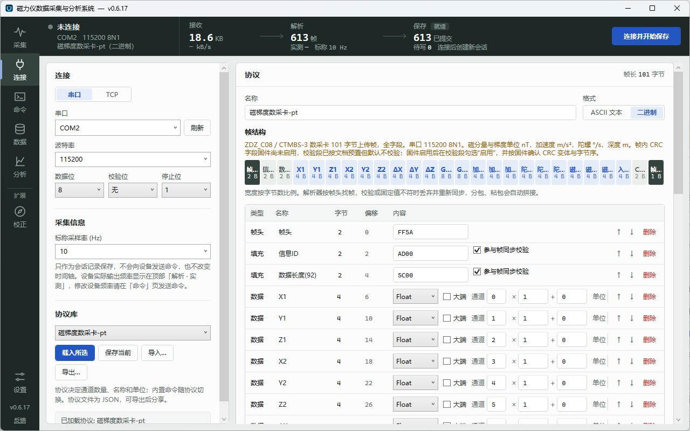
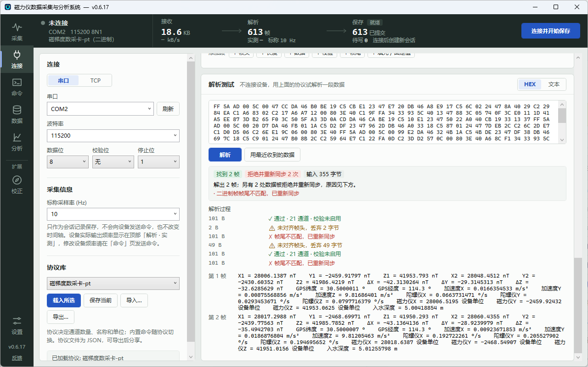
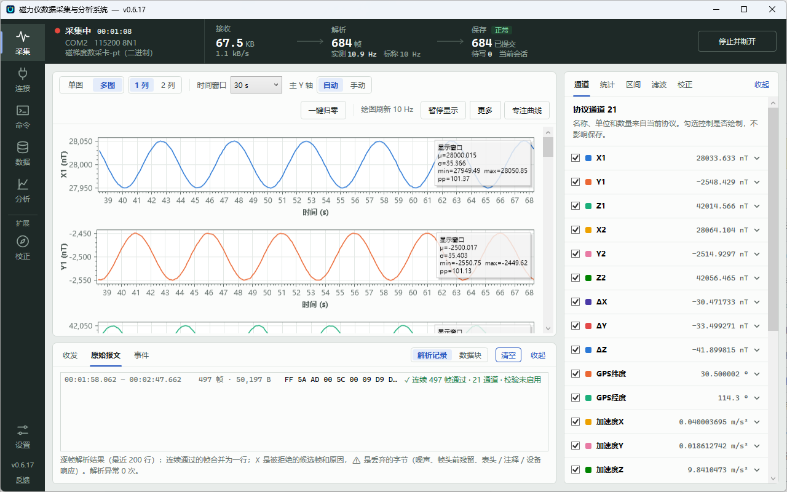
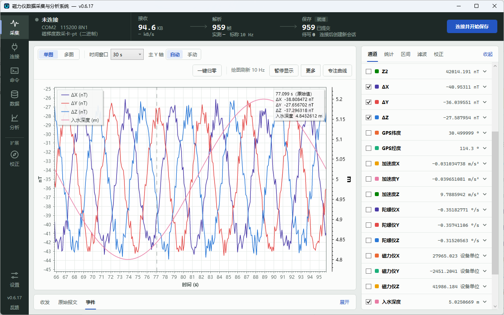
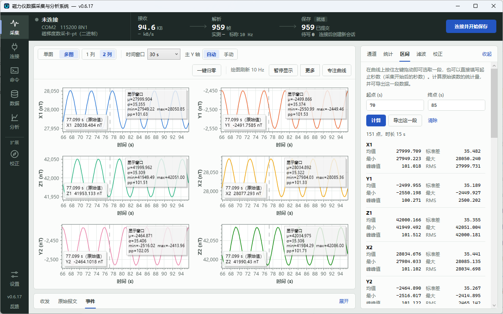
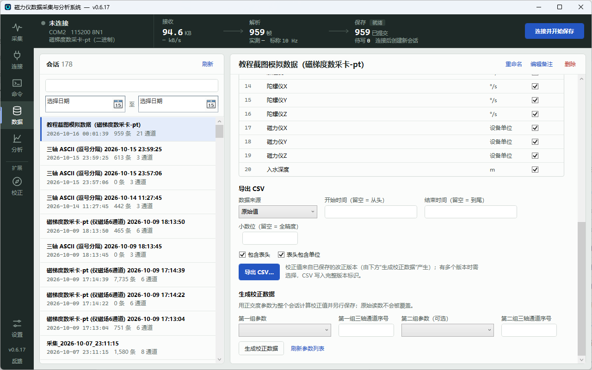

# 快速上手

[返回项目介绍](../README.md) · [English](quick-start.en.md) · [完整使用说明](使用说明.md)

第一次使用时，按下面四步完成一次完整的采集：**选择或配置协议 → 连接设备 → 看曲线 → 导出数据**。命令发送、历史回放、噪声分析和校正等功能放在[进阶功能](#进阶功能)中，日常采集不需要它们。

教程截图以内置协议「磁梯度数采卡-pt」（21 通道）为例，数据来自串口模拟器。

主窗口左侧是页面导航：「采集」「连接」「命令」「数据」「分析」「校正」「设置」。顶部的数据链路条始终显示 接收 → 解析 → 保存 三段计数和实测频率，右上角是「连接并开始保存」按钮。

## 第 1 步：选择或配置协议

协议告诉软件怎样把设备发来的字节拆成通道读数，通道数量、名称和单位都由协议决定。打开「连接」页：

1. **选用已有协议**：在左侧「协议库」下拉框中选择预设或之前保存的协议，点「载入所选」。别人分享的协议 JSON 用「导入…」载入。
2. **按设备输出调整协议**（右侧「协议」面板）：
   - **ASCII 文本**：设置行尾和分隔符，在“字段”表中填写每个通道取第几列、名称、单位和缩放。
   - **二进制**：用「+ 帧头」「+ 长度」「+ 数据」「+ 校验」「+ 帧尾」等按钮按固件文档依次添加段，为每个数据段选择数据类型、字节序、通道序号和单位。上方的字节图按比例显示帧结构，右上角显示帧长。
3. **核对通道**：确认通道顺序、名称和单位与设备一致。单位决定曲线使用哪条纵轴，例如温度通道写 `°C` 后会单独一条轴。
4. **保存**：点「保存当前」存入协议库；需要分享或备份时点「导出…」得到 JSON 文件。

### 先用解析测试核对协议（推荐）

不连接设备也能检查协议是否写对。在「连接」页下方的「解析测试」中粘贴一段设备输出（选择“文本”或“HEX”），点「解析」，“解析过程”会逐帧列出通过的读数、被拒绝的候选帧及原因（帧长、校验、固定值不符等）。连接过设备后，也可以点「用最近收到的数据」直接试解析。

校验段的配置、内置预设的单位与旧协议 JSON 的兼容见[协议校验与通道单位](协议校验与单位.md)。

## 第 2 步：连接设备并开始采集

1. 在「连接」页左侧选择 **串口** 或 **TCP**：
   - 串口：选择端口（看不到时点「刷新」），填写波特率、数据位、校验位和停止位，与设备设置一致。
   - TCP：填写设备的 IP 地址和端口。TCP 断线后会自动重连，重连期间会话保持打开。
2. 填写 **标称采样率 (Hz)**。它只作为会话记录保存，**不会向设备发送命令**；设备实际输出频率看顶部“解析 · 实测”，要修改设备频率请在「命令」页发送设备支持的命令。
3. 点右上角 **「连接并开始保存」**。软件先创建新会话，再开始接收；解析出的读数自动保存到本地数据库，并在「采集」页绘制曲线。
4. 看顶部数据链路条确认三段都在增长：

| 链路条上的现象 | 说明与处理 |
| --- | --- |
| 接收在涨，解析不涨 | 字节到了但协议没对上：打开底部「原始报文 → 解析记录」看被拒原因，回第 1 步调整协议 |
| 接收为 0 | 检查端口、波特率或 IP；有的设备需要先在「命令」页发送启动采样命令 |
| 保存显示失败 | 采集停止接收新数据，已接收的读数留在内存中；排除原因（如磁盘或目录权限）后点「重试写入」 |

底部面板有三个标签：「原始报文」中的「解析记录」逐帧显示解析结论，「数据块」按到达顺序显示收到的原始字节；「收发」记录命令与应答；「事件」记录连接、首帧、会话创建与结束、保存失败等。

5. 采集结束时点 **「停止并断开」**，等按钮从“正在保存尾批…”恢复、「事件」中出现“会话已结束，尾批已提交”后，数据才全部写入数据库。

## 第 3 步：使用曲线

「采集」页中间是曲线，右侧是可收起的工具面板，底部是报文与事件面板。

**单图**：选中的通道画在同一绘图区，不同单位自动使用独立纵轴（下图左侧为 nT，右侧为入水深度的 m 轴）。

**多图（2 列）**：每个通道一张图，双列排列；右侧「区间」页签显示所选时间段的统计量。

**曲线区工具栏**

- **单图 / 多图**：单图把所有选中通道画在同一绘图区，温度等不同单位的通道使用独立纵轴；多图每个通道一张图，可选 1 列或 2 列。
- **时间窗口**：只显示最近多少秒的数据。
- **主 Y 轴**：「自动」按数据自适应，「手动」可填写上下限。
- **暂停显示 / 继续显示**：冻结画面便于观察；**暂停期间采集和保存照常进行**。
- **一键归零 / 取消归零**：把每条曲线按窗口均值平移到 0 附近，便于比较波动；只改变显示，不影响保存和统计。
- **专注曲线**：收起右侧面板和底部面板，让曲线占满窗口；再点「退出专注」恢复。
- **鼠标**：滚轮缩放时间轴，Ctrl + 滚轮缩放 Y 轴（手动范围时）；悬停时显示十字线所在时刻各通道的原始值。
- 「更多」中可以切换「自动滚动到最新」和「显示网格」、设置显示点数上限，或「清空曲线」（只清空显示，不影响已保存的数据）。

**右侧面板**

- **通道**：勾选决定是否绘制（不影响保存），每个通道旁显示最新原始值；可改颜色、显示偏移和显示顺序。
- **统计**：对最近窗口计算均值、标准差、峰峰值、RMS、最小和最大值，使用原始读数。
- **区间**：在曲线上按住左键拖动选取一段（或填写起止秒数），查看这一段的统计量，并可「导出这一段」。
- **计算**：添加总场 `sqrt(A²+B²+C²)`、梯度 `(A−B)/基线距离` 或自定义公式通道。
- **滤波**：只作用于曲线显示；保存、统计和导出始终使用原始读数。

曲线每通道保留最近 100,000 点用于显示和区间分析；更长时段请在「分析」页对已保存会话操作。

## 第 4 步：导出数据

停止采集后打开「数据」页：

1. 在左侧会话列表中选择会话，可按名称或备注搜索、按日期筛选；「重命名」「编辑备注」便于日后查找。
2. 在右侧「导出 CSV」中按需设置：
   - **开始时间 / 结束时间**：留空表示从头到尾，格式 `yyyy-MM-dd HH:mm:ss.fff`；
   - **通道**：勾选要导出的通道（「全选 / 全不选」）；
   - **小数位**：留空保持全精度；
   - **包含表头 / 表头包含单位**；
   - **数据来源**：默认导出原始读数；生成过校正数据的会话也可选择已保存的改正版本。
3. 点「导出 CSV…」选择保存位置。

只需要一小段数据时，也可以在采集页右侧面板的「区间」中拖选后直接「导出这一段」。

## 进阶功能

以下功能按需使用，默认采集不依赖它们，详细说明见[使用说明](使用说明.md)。

- **命令**：按协议关联的命令组填写参数发送，或自由发送 ASCII / HEX。“已写出”只表示本机发送完成，设备是否执行要看应答或数据变化。见[设备命令与响应](使用说明.md#设备命令与响应)。
- **历史回放**：在「数据」页选择会话点「回放」，按记录时间戳和倍速重放曲线，只用于查看、不写入任何会话；连接期间不能回放。
- **分析**：在「分析」页对已保存会话选择时间段，查看噪声、漂移与数据质量。
- **校正**：正交度校正向导拟合参数，可用于实时曲线显示或为历史会话生成校正数据，原始读数始终保留。偏移 / 增益页目前只保存和管理参数，不会套用到采集、曲线或导出。见[数据改正](使用说明.md#数据改正)。
- **设置**：软件更新平台、数据库与日志位置等。
- **反馈与建议**：主窗口状态栏或「关于」窗口中匿名提交问题和需求。

## 没有设备时

- 用第 1 步的**解析测试**核对协议。
- 用 [`tools/serial_simulator`](../tools/serial_simulator/README.md)（需要 Python 和一对虚拟串口）按协议持续发送数据帧，完整体验第 2～4 步。模拟数据只用于熟悉软件和联调，不能代替真实设备验收。
